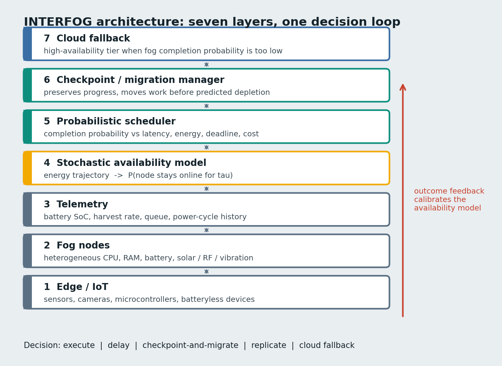

# Architecture



## Decision path

1. **Telemetry** reaches `POST /telemetry` (or the demo ticker) and lands in `NodeStore`, with a short history per node.
2. **Availability** (`AvailabilityService`) turns a node state and a task length τ into `P(node stays on for τ)`.
   The base model is the energy-balance heuristic or a trained survival model. An optional calibrator adjusts the result.
3. **Scheduler** scores every candidate with `α·P − β·L − γ·E − δ·M − ε·C − ζ·V` and walks the decision ladder:
   execute or offload, then replicate, then delay (best-effort only), then cloud, then best-available.
4. **Reassessment** of a running task asks whether the current node will survive the remaining time. If not, and a peer
   is clearly safer, the task is checkpointed and migrated.
5. **Outcomes** reported through `POST /outcomes` feed `POST /models/calibrate`.

## Energy-balance heuristic

```
lifetime = (soc − reserve) · capacity / (consumption − harvest)
P(survive τ) = exp(−(τ / lifetime)^k) · exp(−outage_rate · τ)        k = 2
```

A node whose harvest covers its consumption has unbounded lifetime and only the random-outage term applies.

## Survival models

| Model | Idea |
|---|---|
| Weibull AFT | Log-lifetime is linear in the features; fitted by maximum likelihood with right-censoring |
| Cox PH | Linear log-hazard with a Breslow baseline; Newton-Raphson with a ridge penalty |
| DeepSurv | The same Cox likelihood with a small tanh network, written in numpy |

They train on synthetic lifetimes (25% censored) and are scored on a held-out split with Harrell's C-index and Brier
score at 4, 8, 16 and 32 seconds. To train on your own data, build `X, durations, events` arrays with the columns in
`app/ml.py::FEATURES` and call `train_all`-style fitting on them.

## Scenarios

| ID | Scenario | Condition |
|---|---|---|
| S1 | Stable harvesting | Moderate battery, predictable energy |
| S2 | Energy drought | Harvest drops to 15% |
| S3 | Workload spike | Longer tasks, busier nodes, fuller queues |
| S4 | Repeated interruption | Random outages far more frequent than the model assumes |
| S5 | Heterogeneous fog | Six very different nodes |
| S6 | Prediction uncertainty | Overconfident model, noisy lifetimes |
| S7 | Deadline-critical mix | Mostly critical tasks with tight deadlines |

Strategies compared: latency only, most charged node, random, INTERFOG, INTERFOG with Platt calibration (fitted on a
separate batch of simulated outcomes). The simulator knows each node's true lifetime; the scheduler never does.

## Limits worth knowing

- State lives in memory. Restarting the service clears nodes, decisions and trained models.
- Trained models learn from synthetic data, so on the demo nodes they behave much like the heuristic. They become
  useful once you train on real lifetimes.
- Outcomes exist only for tasks the scheduler chose to run, which biases calibration towards high-probability choices.
